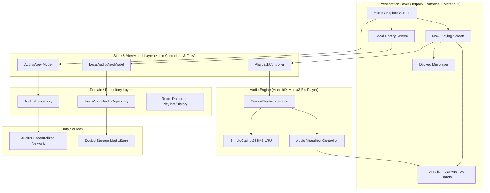

<div align="center">

# 🎵 Vynora — Native Android Music Player & Audius Streaming Engine

<p align="center">
  <strong>Native Android Music Discovery · Keyless Audius Decentralized Streaming · MediaStore Offline Player · Real-Time Bass Visualizer</strong>
</p>

<p align="center">
  
  
  
  
  
  
  
</p>

<p align="center">
  <a href="https://codebyarnob.github.io/Vynora/"><strong>🌐 Official Website</strong></a>
  &nbsp;•&nbsp;
  <a href="https://github.com/CodeByArnob/Vynora/releases/latest"><strong>📦 GitHub Releases (v0.8.0)</strong></a>
  &nbsp;•&nbsp;
  <a href="https://github.com/CodeByArnob/Vynora/releases/latest/download/Vynora-v0.8.0-debug.apk"><strong>📥 1-Click APK Download</strong></a>
  &nbsp;•&nbsp;
  <a href="https://github.com/CodeByArnob/Vynora/releases/latest/download/SHA256SUMS.txt"><strong>🛡️ Checksums</strong></a>
  &nbsp;•&nbsp;
  <a href="https://github.com/CodeByArnob/Vynora/actions/workflows/native-android-ci.yml"><strong>🏗️ CI Build Logs</strong></a>
</p>

<br />

<p align="center">
  
</p>

</div>

---

## ⚡ Application Overview (`v0.8.0`)

**Vynora** is an open-source, production-grade native Android music player engineered for audiophiles and music lovers. It pairs a **Spotify-inspired Material 3 dark aesthetic** with **decentralized, 100% keyless Audius music streaming**, **instant offline MediaStore playback** (MP3, FLAC, WAV, M4A, OGG), and a **hardware-accelerated 28-band bass-reactive FFT audio visualizer**.

Audius is the single authorized online music discovery and streaming provider, operating completely keyless without requiring Google Cloud API keys, YouTube tokens, or video player wrappers.

---

## 📥 1-Click APK Download & Release Assets

The latest verified Android build is published under [**GitHub Releases (`v0.8.0`)**](https://github.com/CodeByArnob/Vynora/releases/latest):

| Release Asset | Direct 1-Click Download | File Size | Verification Status |
| :--- | :--- | :--- | :--- |
| **`Vynora-v0.8.0-debug.apk`** | [**⬇️ Download APK (v0.8.0)**](https://github.com/CodeByArnob/Vynora/releases/latest/download/Vynora-v0.8.0-debug.apk) | `26.9 MB` | Android Signature v2 Verified |
| **`Vynora-latest.apk`** | [**⬇️ Download Latest APK**](https://github.com/CodeByArnob/Vynora/releases/latest/download/Vynora-latest.apk) | `26.9 MB` | Android Signature v2 Verified |
| **`SHA256SUMS.txt`** | [**📄 View SHA-256 Digest**](https://github.com/CodeByArnob/Vynora/releases/latest/download/SHA256SUMS.txt) | `175 B` | Verified Match |

### 🛡️ Cryptographic Verification
```bash
# Verify the integrity of the downloaded APK
sha256sum -c SHA256SUMS.txt
# Output:
# Vynora-v0.8.0-debug.apk: OK
# Vynora-latest.apk: OK
```
**SHA-256 Digest:**
```
25B4482756FF86C8DE498236BD6E48C6887A1540BA7D45E2EBB84227183BB89B
```

---

## 📱 In-App Mobile Screenshot Gallery

Authentic in-app screenshots captured directly from an active Android device running Vynora v0.8.0:

<div align="center">
<table>
  <tr>
    <td align="center" width="20%">
      <br />
      <sub><b>Now Playing</b><br />28-band FFT &amp; Amber Glow</sub>
    </td>
    <td align="center" width="20%">
      <br />
      <sub><b>Home Discovery</b><br />Indian Music &amp; Audius Trends</sub>
    </td>
    <td align="center" width="20%">
      <br />
      <sub><b>Explore &amp; Charts</b><br />Direct Online Streaming</sub>
    </td>
    <td align="center" width="20%">
      <br />
      <sub><b>Local Library</b><br />45 Device Tracks &amp; Filter</sub>
    </td>
    <td align="center" width="20%">
      <br />
      <sub><b>Album Detail</b><br />Uncut Bollywood Collection</sub>
    </td>
  </tr>
</table>
</div>

<p align="center">
  
</p>

---

## 🌟 Key Features & Technical Capabilities

### 1. 🌐 100% Keyless Audius Decentralized Streaming
- **Zero API Keys Required**: No Google Cloud console setup, no `YOUTUBE_API_KEY`, no video quota restrictions.
- **Dynamic Node Rotation**: Automatically queries `https://api.audius.co` to retrieve live, low-latency API host nodes with graceful failover.
- **Direct Stream URL Resolution**: Fast, unthrottled streaming endpoints with immediate playback start.
- **Search & Discovery**: Full text search for tracks, trending charts (all-time, monthly, weekly), artist profiles, and genre discovery.

### 2. 🎛️ Real-Time 28-Band Hardware FFT Audio Visualizer
- **Native Android Visualizer API**: Hooks directly into ExoPlayer's active audio session ID (`audioSessionId`), capturing raw frequency spectrum data with zero mic latency.
- **Bass-Reactive Equalizer**: 28 logarithmic frequency bands emphasizing sub-bass (20–80Hz), mid-bass (80–250Hz), and vocal clarity.
- **Peak-Hold Floating Indicators**: Physics-based gravity decay on peak dots for a fluid, professional studio visualizer look.
- **Dynamic Ambient Album-Art Glow**: Real-time color palette extraction generates synchronized ambient backlight that matches the playing album cover.
- **Dual Visualizer Modes**: Instant toggle between Hardware Audio Session FFT and Microphone FFT fallback.

### 3. 📂 Local Android MediaStore Audio Library
- **Complete Offline Playback**: Automatic background indexing of device audio files (MP3, FLAC, WAV, M4A, OGG).
- **Fast Search & Instant Filtering**: Instant in-memory search across title, artist, album, and duration.
- **Room SQLite Persistence**: Saves user favorites, custom playlists, recent playback history, and play queues.

### 4. 🚀 AndroidX Media3 (ExoPlayer 1.5.1) Audio Pipeline
- **256MB LRU Disk Caching**: Powered by `SimpleCache` and `LeastRecentlyUsedCacheEvictor` to eliminate re-buffering and conserve mobile data.
- **Resilient Prefetching**: Automatically prebuffers upcoming tracks in the queue for instantaneous next/previous transitions.
- **Background MediaSessionService**: Robust `VynoraPlaybackService` keeps audio playing smoothly during app minimization, screen lock, and device switching.
- **Rich Media Notifications**: Standard Android MediaStyle notifications with playback controls, progress scrubbing, and album art.
- **Audio Focus & Headset Management**: Automatic pause on incoming calls or headset disconnect (`AUDIOFOCUS_LOSS_TRANSIENT`, `ACTION_AUDIO_BECOMING_NOISY`).

### 5. 🎨 Modern Material 3 & Jetpack Compose UI
- **Docked Floating Miniplayer**: Persistent across all app navigation tabs with play/pause, title, artist, and tap-to-expand.
- **Custom Sleep Timer**: Smooth bottom sheet modal to set auto-stop timers (15m, 30m, 45m, 60m, or end of track).
- **Edge-to-Edge Fluid Animations**: High-performance declarative Compose components rendered at up to 120Hz.

---

## 🏗️ Architecture & Streaming Pipeline

<p align="center">
  
</p>



---

## 🛠️ Technology Stack & Dependencies

| Layer | Technology | Version | Purpose |
| :--- | :--- | :--- | :--- |
| **Language** | Kotlin | `2.1.0` | Primary language with Coroutines & StateFlow |
| **UI Framework** | Jetpack Compose | BOM `2024.12.01` | Declarative UI, edge-to-edge layout, animations |
| **Design System**| Material 3 | `1.3.1` | Dark theme, dynamic color extraction, components |
| **Audio Engine** | AndroidX Media3 (ExoPlayer) | `1.5.1` | Audio streaming, caching, buffering, playback |
| **Background** | Media3 MediaSession | `1.5.1` | Background service, lockscreen controls, notifications |
| **Local DB** | Room SQLite | `2.6.1` | Playlists, favorite tracks, playback history |
| **Networking** | Retrofit & OkHttp | `2.11.0` / `4.12.0`| Keyless Audius REST API client & stream caching |
| **Serialization**| Kotlinx Serialization | `1.7.3` | JSON parsing for Audius node responses |
| **Image Loading**| Coil Compose | `2.7.0` | Asynchronous artwork loading and memory caching |
| **Target SDK** | Android 16 (VanillaIceCream) | API `36` | Latest Android platform capabilities |
| **Min SDK** | Android 8.0 (Oreo) | API `26` | Broad device compatibility |

---

## 📂 Project Structure

```
Vynora/
├── app/
│   ├── src/main/java/com/vynora/
│   │   ├── MainActivity.kt               # Main entry point & Jetpack Compose root
│   │   ├── VynoraApplication.kt          # Application initialization & DI setup
│   │   ├── audio/                        # Audio engine & Media3 playback
│   │   │   ├── PlaybackController.kt     # High-level playback actions & state
│   │   │   ├── VynoraPlaybackService.kt  # MediaSessionService background service
│   │   │   ├── VisualizerController.kt   # Android Visualizer hardware FFT capture
│   │   │   └── SleepTimerManager.kt      # Playback sleep timer management
│   │   ├── data/                         # Data layer & repositories
│   │   │   ├── audius/                   # Audius decentralized API integration
│   │   │   │   ├── AudiusApiClient.kt   # Dynamic node selection & network calls
│   │   │   │   ├── AudiusRepository.kt  # Search, trending & stream resolution
│   │   │   │   ├── AudiusSearchEngine.kt# Phonetic typo-tolerant local search index
│   │   │   │   └── AudiusModels.kt      # Audius data models & serialization
│   │   │   ├── local/                    # Local storage & database
│   │   │   │   ├── LocalAudioRepository.kt # MediaStore audio content resolver
│   │   │   │   ├── AppDatabase.kt       # Room SQLite database definition
│   │   │   │   └── AudioDao.kt          # Favorites & history database access
│   │   │   └── cache/                    # Disk cache & prefetch logic
│   │   │       └── MediaCacheManager.kt  # Media3 256MB SimpleCache configuration
│   │   ├── ui/                           # Jetpack Compose UI
│   │   │   ├── screens/                  # Application screens
│   │   │   │   ├── HomeScreen.kt         # Featured Indian music & trending streams
│   │   │   │   ├── ExploreScreen.kt      # Audius charts & genre exploration
│   │   │   │   ├── LibraryScreen.kt      # Local MediaStore tracks & search
│   │   │   │   ├── NowPlayingScreen.kt   # Fullscreen player with 28-band FFT
│   │   │   │   └── PlaylistScreen.kt     # Album & playlist detail view
│   │   │   ├── components/               # Reusable UI components
│   │   │   │   ├── AudioVisualizerView.kt# Compose 28-band FFT canvas
│   │   │   │   ├── MiniPlayer.kt         # Docked floating miniplayer
│   │   │   │   └── SleepTimerDialog.kt   # Bottom sheet sleep timer modal
│   │   │   └── theme/                    # Material 3 colors, typography & shapes
│   │   └── viewmodel/                    # State management & ViewModels
│   │       ├── AudiusViewModel.kt       # Trending streams & search state
│   │       ├── LocalAudioViewModel.kt   # Local tracks & playlist state
│   │       └── PlayerViewModel.kt       # Playback position, queue & visualizer
│   └── src/test/java/com/vynora/         # Comprehensive unit tests (19 passing)
├── docs/                                 # Official GitHub Pages website & assets
│   ├── index.html                        # Product landing page
│   ├── styles.css                        # Modern dark responsive styling
│   ├── app.js                            # Interactive visualizer canvas demo
│   ├── 404.html                          # Branded error page
│   └── assets/                           # Screenshots, SVGs, and app icon
└── .github/workflows/                    # CI/CD automation pipelines
    ├── native-android-ci.yml             # Lint, unit test & APK build validation
    └── pages.yml                         # Automated GitHub Pages deployment
```

---

## 💻 Build & Development Setup

### Prerequisites
- **JDK**: Java Development Kit 17 (OpenJDK or Oracle)
- **Android SDK**: Build Tools `36.0.0`, Platform `android-36`
- **IDE**: Android Studio Ladybug (2024.2+) or Meerkat

### Building from Source
```bash
# 1. Clone the repository
git clone https://github.com/CodeByArnob/Vynora.git
cd Vynora

# 2. Run unit tests
./gradlew testDebugUnitTest

# 3. Run Android Lint verification
./gradlew lintDebug

# 4. Build debug APK
./gradlew assembleDebug

# Output APK path:
# app/build/outputs/apk/debug/app-debug.apk
```

---

## 🔒 Android Permissions

| Permission | Purpose | Mandatory? |
| :--- | :--- | :--- |
| `READ_MEDIA_AUDIO` | Required on Android 13+ (API 33+) to read local music files | Yes (for local library) |
| `READ_EXTERNAL_STORAGE` | Required on Android 8.0–12 (API 26–32) for local audio access | Yes (for local library) |
| `INTERNET` | Required to fetch Audius trending music and stream audio | Yes |
| `ACCESS_NETWORK_STATE` | Monitors connection quality to optimize caching & buffer sizes | Yes |
| `FOREGROUND_SERVICE` | Keeps audio playback alive when the app is in the background | Yes |
| `FOREGROUND_SERVICE_MEDIA_PLAYBACK` | Android 14+ specific foreground service type for media | Yes |
| `POST_NOTIFICATIONS` | Displays playback controls in the Android notification drawer | Recommended |
| `RECORD_AUDIO` | Only used when explicitly switching visualizer to Mic FFT mode | Optional |

---

## 🤝 Contributing

Contributions from the open-source community are warmly welcome!
1. Fork the repository.
2. Create your feature branch (`git checkout -b feature/amazing-feature`).
3. Commit your changes (`git commit -m 'feat: add amazing feature'`).
4. Ensure all tests and lint checks pass (`./gradlew check`).
5. Push to your branch (`git push origin feature/amazing-feature`).
6. Open a Pull Request.

---

## 📄 License

Vynora is open-source software licensed under the **Apache License 2.0**. See the [LICENSE](LICENSE) file for more information.

---

<div align="center">
  <sub>Crafted with ❤️ by <a href="https://github.com/CodeByArnob">Arnob</a> · Native Android &amp; Audius Decentralized Audio</sub>
</div>
