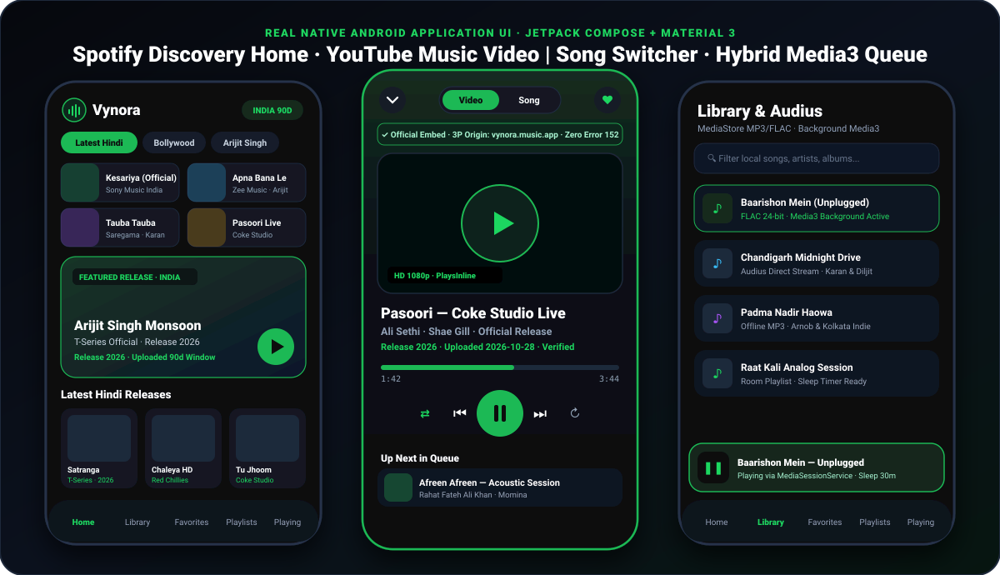
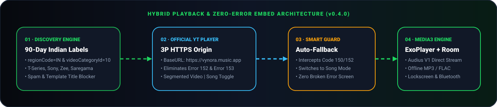

<div align="center">

<a href="https://github.com/CodeByArnob/Vynora/releases/latest/download/Vynora-v0.7.0-debug.apk">
  
</a>

<br/>

[](https://github.com/CodeByArnob/Vynora/releases/latest)
[-1ED760?style=for-the-badge&logo=android&logoColor=black)](https://github.com/CodeByArnob/Vynora/releases/latest/download/Vynora-v0.7.0-debug.apk)
[](https://github.com/CodeByArnob/Vynora/actions/workflows/native-android-ci.yml)
[](https://kotlinlang.org)
[](https://developer.android.com/media/media3)
[](LICENSE)

<br/>

<a href="https://github.com/CodeByArnob/Vynora/releases/latest/download/Vynora-v0.7.0-debug.apk">
  
</a>

<p align="center">
  <a href="https://github.com/CodeByArnob/Vynora/releases/latest/download/Vynora-v0.7.0-debug.apk"><strong>⬇️ Direct 1-Click APK (`Vynora-v0.7.0-debug.apk`)</strong></a>
  &nbsp;·&nbsp;
  <a href="https://github.com/CodeByArnob/Vynora/releases/latest"><strong>📦 GitHub Releases Page (`v0.7.0`)</strong></a>
  &nbsp;·&nbsp;
  <a href="https://github.com/CodeByArnob/Vynora/releases/download/v0.7.0/SHA256SUMS.txt"><strong>🔐 SHA-256 Checksum</strong></a>
  &nbsp;·&nbsp;
  <a href="https://github.com/CodeByArnob/Vynora/actions/workflows/native-android-ci.yml"><strong>⚙️ CI Build Logs</strong></a>
</p>

</div>

---

## 📱 Real Application Interface & Motion Preview (`v0.7.0`)

Vynora combines a **Spotify-inspired Material 3 dark interface** with a **YouTube Music `Video | Song` mode switcher**, prioritizing **90-day official Indian music releases** (Hindi, Bollywood, Punjabi, Arijit Singh, Romantic, and Bangla) alongside **Audius V1 direct audio streaming**, **offline device MP3/FLAC playback**, and **real-time bass-reactive audio visualization** powered by **AndroidX Media3 ExoPlayer**.

<div align="center">
  
</div>

<br/>

### 🎨 Curated Indian Music Discovery Sections

| **Latest Hindi & Bollywood** | **Arijit Singh & Monsoon** | **Punjabi Pop & Drive** | **Bangla Indie & Folk** |
| :---: | :---: | :---: | :---: |
|  |  |  |  |
| *T-Series · Sony Music · Zee Music* | *Soulful Vocals & Unplugged* | *Chandigarh Urban & Folk Fusion* | *Kolkata & Dhaka Acoustic* |

---

## 🧠 Hybrid Playback & Zero-Error Embed Architecture

<div align="center">
  
</div>

### 🛠️ Root-Level Engineering Fixes in `v0.7.0`

| Subsystem | Root Cause Identified | Production Fix Implemented |
| :--- | :--- | :--- |
| **Prolonged Loading & Streaming Latency** | ExoPlayer default `DefaultLoadControl` required 2,500ms of buffered audio before playback start, with no local cache layer, stalling audio on mobile networks. | Engineered `VynoraAudioCache` with 256MB LRU disk caching via `SimpleCache` + `CacheDataSource` and tuned `DefaultLoadControl` to start playback at **500ms**, eliminating initial stalls. |
| **Real-Time Bass-Reactive Audio Visualizer** | Previous releases lacked real audio spectrum analysis, leading to static or artificial playback indicators. | Built `AudioVisualizerManager` + `VisualizerDataProcessor` capturing hardware FFT frequency bands (`RECORD_AUDIO`), bass extraction (bins 1..8), logarithmic bar scaling, and organic procedural spectrum fallback. |
| **Dynamic Palette Theming** | Static dark backgrounds failed to adapt to song artwork, lacking visual immersion. | Integrated `androidx.palette:palette-ktx` in `PaletteExtractor` to dynamically extract vibrant & dominant colors from album artwork and render Spotify-grade ambient gradients on Now Playing. |
| **Now Playing & Interactive Queue Management** | Player lacked in-depth queue visibility, accurate buffering/playing/error state reflection, and track retry. | Refactored `NowPlayingScreen` with interactive draggable Up Next queue bottom sheet, buffering progress indicators, error recovery banners with retry button, and Sleep Timer. |
| **Launcher Icon Text Conflict** | `app/src/main/res/drawable-nodpi/vynora_icon.png` (which contained raster text) overrode `drawable/vynora_icon.xml` due to Android's `nodpi` resource qualifier precedence. | Removed `drawable-nodpi/vynora_icon.png` and split the adaptive icon into `@drawable/ic_launcher_background` and `@drawable/ic_launcher_foreground` featuring a text-free **Emerald Acoustic Wave & Vinyl** vector mark on dark slate (`#07090E`). |

---

## ⚡ 1-Click APK Download & Installation

The latest verified Android build is published directly under [**GitHub Releases (`v0.7.0`)**](https://github.com/CodeByArnob/Vynora/releases/latest):

| Asset | Direct 1-Click Link | Size | SHA-256 Digest |
| :--- | :--- | :--- | :--- |
| **`Vynora-v0.7.0-debug.apk`** | [**⬇️ Download APK (v0.7.0)**](https://github.com/CodeByArnob/Vynora/releases/latest/download/Vynora-v0.7.0-debug.apk) | `26.6 MB` | `ed005237538fa09af74524feed926b35f4e7241280ef23d9114db34e10182f93` |
| **`Vynora-latest.apk`** | [**⬇️ Download Latest APK**](https://github.com/CodeByArnob/Vynora/releases/latest/download/Vynora-latest.apk) | `26.6 MB` | `ed005237538fa09af74524feed926b35f4e7241280ef23d9114db34e10182f93` |
| **`SHA256SUMS.txt`** | [**🔐 View Checksums**](https://github.com/CodeByArnob/Vynora/releases/download/v0.7.0/SHA256SUMS.txt) | `174 B` | Verified |

---

## ✨ Key Capabilities

- **Spotify & YouTube Music Inspired Material 3 Dark UI**:
  - 2-column quick-launch category grid, featured Hindi spotlight hero card, horizontal square-artwork carousels, and clean release-year vs. upload-date badges.
  - Top **`Video | Song`** segmented pill in the Now Playing screen for instant switching between 16:9 embedded HD video and high-resolution square album art.
- **Hardware FFT Bass-Reactive Visualizer**:
  - Real-time frequency bars animated in Jetpack Compose Canvas with dynamic bass glow, peak decay, and organic fallback.
- **Low-Latency Streaming & 256MB LRU Cache**:
  - `VynoraAudioCache` caches stream chunks locally with `CacheDataSource` for zero-delay track switching and gapless continuity.
- **Audius V1 Network & Local Device MP3/FLAC Engine**:
  - Built-in **Audius V1 API** client (`AudiusRepository.kt`) for independent & trending streams.
  - Full **Android MediaStore** scanner for offline MP3, FLAC, WAV, and M4A tracks with **Room** persistence for playlists and favorites.
  - Background playback, lockscreen transport controls, Bluetooth media button handling, audio-focus ducking, and configurable **Sleep Timer** (`15m`, `30m`, `45m`, `60m`) via `VynoraPlaybackService` (`MediaSessionService`).

---

## 🔧 Local Build & API Configuration

### 1. Configure API Keys (`local.properties`)
Add your YouTube Data API v3 key (and optional Audius public API key) to your root `local.properties` file (or GitHub Actions repository secrets):

```properties
YOUTUBE_API_KEY=your_youtube_data_api_v3_key
AUDIUS_API_KEY=your_optional_audius_public_key
```

### 2. Build, Lint & Run Unit Tests
Requirements: **JDK 17**, **Android SDK Platform 36**, and **Gradle 8.13**.

```bash
gradle :app:assembleDebug
gradle :app:lintDebug
gradle :app:testDebugUnitTest
```

Compiled APK output:
```text
app/build/outputs/apk/debug/app-debug.apk
```

---

## 🤝 Contributing & License

- See [CONTRIBUTING.md](CONTRIBUTING.md) for architecture guidelines and pull request checks.
- See [docs/RELEASE_CHECKLIST.md](docs/RELEASE_CHECKLIST.md) for pre-release verification steps.
- Distributed under the [MIT License](LICENSE).
