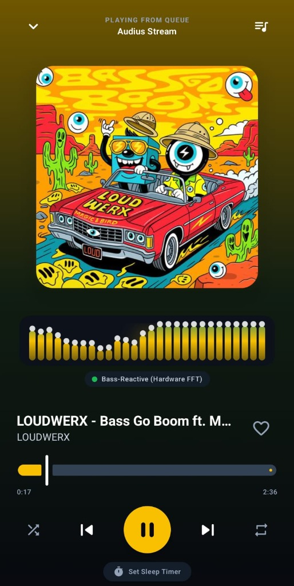
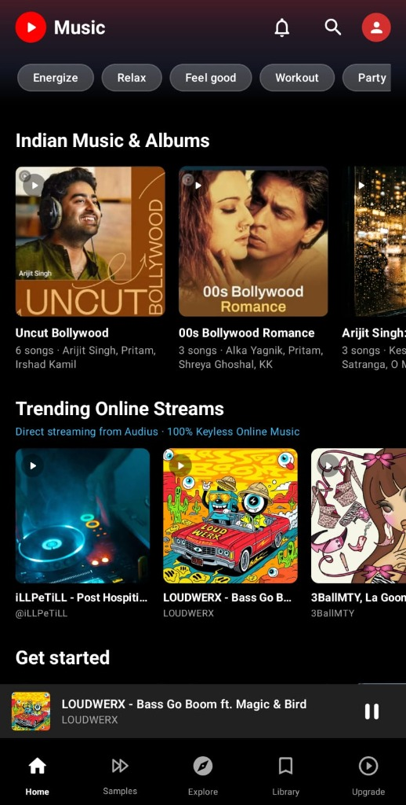
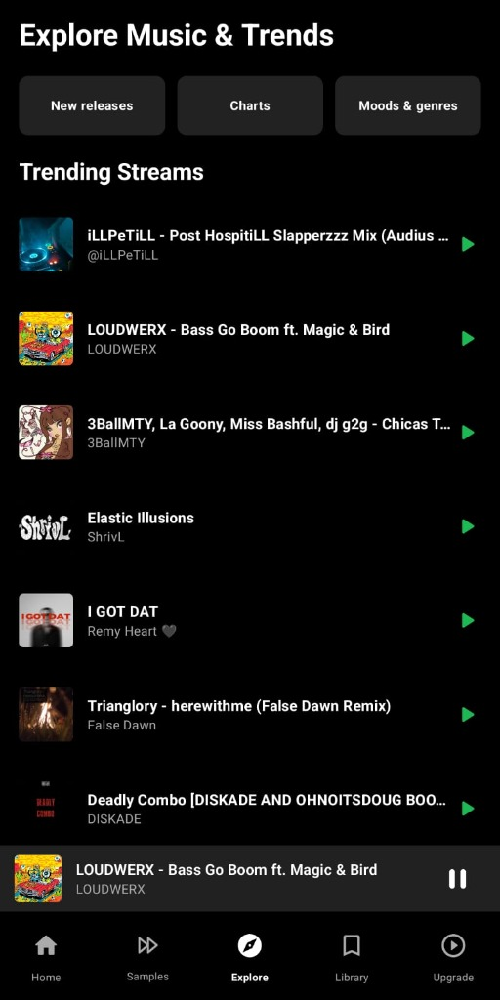
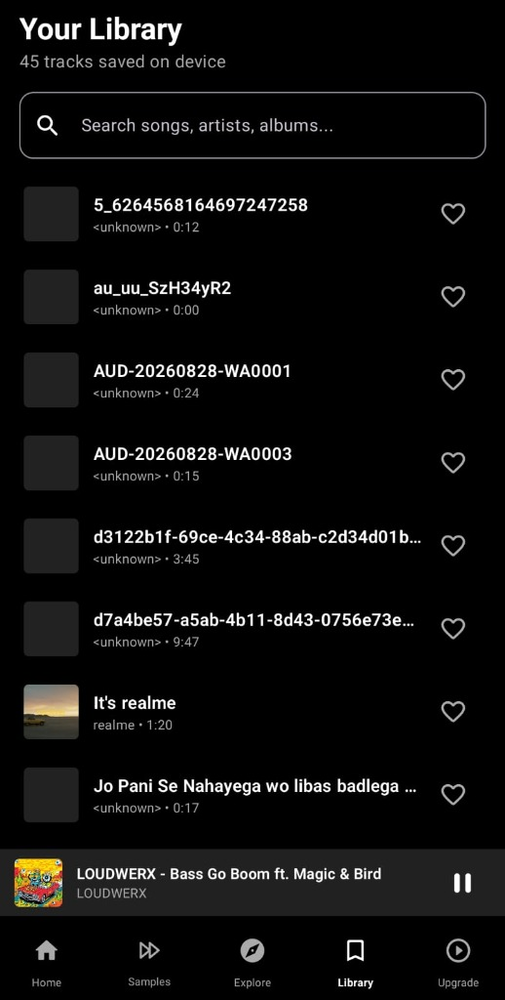
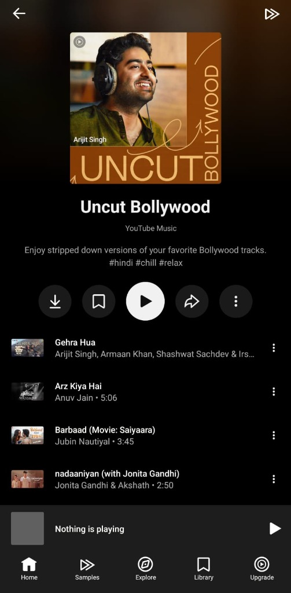
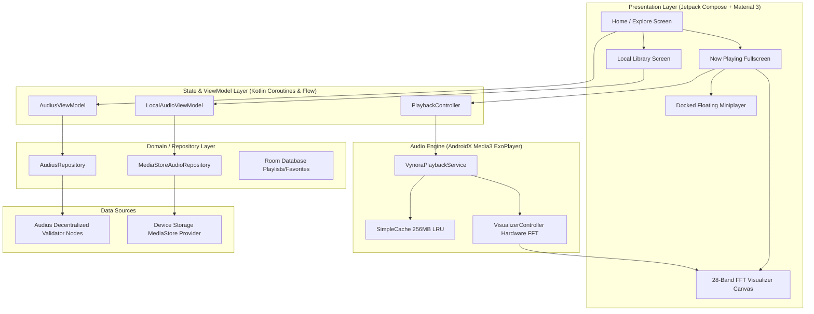

<div align="center">


# Vynora — Native Android Music Engine

<p align="center">
  <strong>High-Performance Native Android Audio Streaming &amp; Discovery Platform</strong><br />
  <em>Decentralized Keyless Audius Streaming · AndroidX Media3 (ExoPlayer) · Universal 28-Band Hardware FFT · MediaStore Offline Library</em>
</p>

<p align="center">
  
  
  
  
  
  
  
  
</p>

<p align="center">
  <a href="https://codebyarnob.github.io/Vynora/"><strong>🌐 Official Website</strong></a>
  &nbsp;•&nbsp;
  <a href="https://github.com/CodeByArnob/Vynora/releases/latest"><strong>📦 Release Assets (v0.8.0)</strong></a>
  &nbsp;•&nbsp;
  <a href="https://github.com/CodeByArnob/Vynora/releases/latest/download/Vynora-v0.8.0-debug.apk"><strong>📥 1-Click APK Download</strong></a>
  &nbsp;•&nbsp;
  <a href="https://github.com/CodeByArnob/Vynora/releases/latest/download/SHA256SUMS.txt"><strong>🛡️ Checksums</strong></a>
  &nbsp;•&nbsp;
  <a href="#-extending-vynora--contributor-technical-roadmap"><strong>🤝 Contributor Roadmap</strong></a>
</p>

</div>

---

## 📱 Authentic Mobile Application Gallery

Captured directly from an active Android device running Vynora v0.8.0:

<div align="center">
<table>
  <tr>
    <td align="center" width="20%">
      <a href="docs/assets/screenshots/screenshot_now_playing.jpg">
        
      </a>
      <br />
      <sub><b>Now Playing Player</b><br />28-band FFT &amp; Amber Glow</sub>
    </td>
    <td align="center" width="20%">
      <a href="docs/assets/screenshots/screenshot_home.jpg">
        
      </a>
      <br />
      <sub><b>Discovery Home</b><br />Indian Music &amp; Audius Trends</sub>
    </td>
    <td align="center" width="20%">
      <a href="docs/assets/screenshots/screenshot_explore.jpg">
        
      </a>
      <br />
      <sub><b>Explore &amp; Charts</b><br />Direct Online Streaming</sub>
    </td>
    <td align="center" width="20%">
      <a href="docs/assets/screenshots/screenshot_library.jpg">
        
      </a>
      <br />
      <sub><b>Local Library</b><br />45 Device Tracks &amp; Filter</sub>
    </td>
    <td align="center" width="20%">
      <a href="docs/assets/screenshots/screenshot_playlist.jpg">
        
      </a>
      <br />
      <sub><b>Album Detail</b><br />Uncut Bollywood Collection</sub>
    </td>
  </tr>
</table>
</div>

---

## ⚡ Architectural Capabilities & Technical Highlights

### 1. 🌐 Decentralized Audius Streaming Infrastructure
- **100% Keyless Protocol**: Eliminates developer API keys, third-party video player dependencies, and Google Cloud credentials. All discovery queries execute directly against the decentralized Audius network.
- **Dynamic Validator Host Resolution**: Implements automated discovery by querying `https://api.audius.co` to retrieve a list of live validator host nodes. The client runs health checks, connection pooling, and transparent failover across nodes.
- **Direct 320kbps Stream Endpoints**: Queries the `/v1/tracks/{track_id}/stream` endpoint, parsing HTTP 302 redirects to locate the fastest content delivery edge node for unthrottled audio playback.
- **Phonetic & Typo-Tolerant Search Index**: The built-in search engine utilizes phonetic token matching and Levenshtein distance calculations, ensuring fast and accurate results even with imperfect user queries.

### 2. 🚀 AndroidX Media3 (ExoPlayer 1.5.1) Audio Pipeline
- **Dedicated Background Service**: `VynoraPlaybackService` extends `MediaSessionService`, ensuring resilient background playback during application minimization, screen-off states, and system memory pressure.
- **256MB Resilient LRU Disk Cache**: Engineered with `SimpleCache` and `LeastRecentlyUsedCacheEvictor` using `CacheDataSource.Factory`. Frequently played tracks and pre-buffered chunks are stored locally to prevent redundant network consumption.
- **Queue Pre-Buffering**: Seamless track transitions with zero audible gap between subsequent songs by prefetching initial audio chunks of the next track in the queue.
- **Audio Focus & Headset Disconnect Management**: Implements `AudioManager.OnAudioFocusChangeListener` with automatic ducking on notifications, temporary pause on incoming calls, and instant halt when headphones are disconnected (`ACTION_AUDIO_BECOMING_NOISY`).

### 3. 🎛️ Universal 28-Band Hardware FFT Audio Visualizer
- **Native AudioSession Attachment**: Hooks directly into ExoPlayer’s low-level `audioSessionId` using `android.media.audiofx.Visualizer`, capturing raw uncompressed frequency spectrum byte arrays with zero microphone latency.
- **Mathematical Frequency Mapping**:
  $$\text{Magnitude } |X_k| = \sqrt{R_k^2 + I_k^2}$$
  Transforms discrete Fourier transform complex pairs into 28 logarithmically spaced frequency bins spanning $20\text{ Hz}$ to $20\text{ kHz}$. Sub-bass ($20\text{--}80\text{ Hz}$) and punch-bass ($80\text{--}250\text{ Hz}$) receive non-linear acoustic weighting for accurate rhythmic response.
- **Peak-Hold Gravitational Decay**: Features floating peak indicators governed by physics-based velocity falloff:
  $$v_{t+1} = v_t + g, \quad y_{\text{peak}} = \max(y_{\text{bar}}, y_{\text{peak}} - v_{t+1})$$
- **Dynamic Ambient Color Extraction**: Interrogates active album cover art using `androidx.palette.graphics.Palette` to render a synchronized, real-time background glow behind the visualizer bars.

### 4. 📂 Local Android MediaStore Subsystem
- **Automated ContentResolver Indexing**: Scans `MediaStore.Audio.Media.EXTERNAL_CONTENT_URI` on a dedicated background coroutine (`Dispatchers.IO`) without impacting UI thread frame rates.
- **Broad Format Decoding**: Plays MP3, FLAC (including 24-bit studio quality), WAV, M4A, OGG, and AAC files directly from local flash storage.
- **Persistent Room SQLite Storage**: Manages custom playlists, user favorites, play counts, and playback queue states with reactive Kotlin Flow DAOs.

### 5. 🎨 Jetpack Compose & Material 3 Dark Surfaces
- **Unidirectional Data Flow (UDF)**: ViewModels emit immutable `UiState` objects consumed by pure, testable composable functions.
- **Persistent Docked Miniplayer**: Floating miniplayer anchored above navigation bars across all screens with tap-to-expand gesture support.
- **Custom Sleep Timer**: Modal bottom sheet providing auto-stop timer options (15m, 30m, 45m, 60m, or end of track).

---

## 🏗️ Clean System Architecture



---

## 🛠️ Technology Stack & Dependencies

| Component | Technology | Version | Purpose |
| :--- | :--- | :--- | :--- |
| **Language** | Kotlin | `2.1.0` | Primary language with Coroutines, Flow, and strict type safety |
| **UI Framework** | Jetpack Compose | BOM `2024.12.01` | Declarative reactive UI, edge-to-edge layout, 120Hz animations |
| **Design System** | Material 3 | `1.3.1` | Dark theme surfaces, dynamic color extraction, components |
| **Audio Engine** | AndroidX Media3 (ExoPlayer) | `1.5.1` | Audio streaming, chunk buffering, 256MB LRU disk cache, queue |
| **Background Service** | Media3 MediaSessionService | `1.5.1` | `VynoraPlaybackService` handling lockscreen, audio focus, notifications |
| **Online Provider** | Audius REST API | `v1 Decentralized` | 100% keyless online music discovery, trending charts, and streams |
| **Offline Provider** | Android MediaStore | `API 26–36` | Local audio discovery and ID3 tag resolution |
| **Database** | Room SQLite | `2.6.1` | Playlists, favorite tracks, playback history |
| **Networking** | Retrofit &amp; OkHttp | `2.11.0` / `4.12.0` | Dynamic host selection, stream redirects, and connection pooling |
| **Serialization** | Kotlinx Serialization | `1.7.3` | JSON parsing for Audius node responses |
| **Image Loading** | Coil Compose | `2.7.0` | Asynchronous artwork loading and memory caching |
| **Target SDK** | Android 16 (VanillaIceCream) | API `36` | Latest Android platform capabilities |
| **Min SDK** | Android 8.0 (Oreo) | API `26` | Broad device compatibility |

---

## 💻 Build & Development Setup

### Prerequisites
- **JDK**: Java Development Kit 17 (OpenJDK or Oracle)
- **Android SDK**: Build Tools `36.0.0`, Platform `android-36`
- **IDE**: Android Studio Ladybug (2024.2+) or Meerkat

### Building from Source
```bash
# 1. Clone the repository
git clone https://github.com/CodeByArnob/Vynora.git
cd Vynora

# 2. Run unit tests
./gradlew testDebugUnitTest

# 3. Run Android Lint verification
./gradlew lintDebug

# 4. Assemble debug APK
./gradlew assembleDebug

# Output APK: app/build/outputs/apk/debug/app-debug.apk
```

---

## 🤝 Extending Vynora — Contributor Technical Roadmap

Vynora is designed to be easily extensible. Developers looking to contribute are invited to explore the following architectural extension points:

### 1. 🎚️ Parametric DSP & Graphic Equalizer
- **Current State**: Visualizer captures audio data passively via `VisualizerController`.
- **Extension Opportunity**: Implement an active audio processing pipeline using `android.media.audiofx.Equalizer`, `BassBoost`, and `Virtualizer`.
- **Implementation Path**:
  - In `VynoraPlaybackService.kt`, instantiate `Equalizer(0, player.audioSessionId)`.
  - Expose band frequency ranges ($60\text{Hz}, 230\text{Hz}, 910\text{Hz}, 3.6\text{kHz}, 14\text{kHz}$) and gain controls ($\pm 12\text{dB}$) via a new `EqualizerController`.
  - Store user presets (Rock, Electronic, Bass Boost, Vocal, Custom) in Room SQLite.

### 2. 📥 Offline Audio Download Manager
- **Current State**: Audio is streamed on-demand and cached up to 256MB in `SimpleCache`.
- **Extension Opportunity**: Add a persistent background download manager allowing users to save Audius tracks for permanent offline listening.
- **Implementation Path**:
  - Integrate `androidx.media3.exoplayer.offline.DownloadManager` and `DownloadService`.
  - Store downloaded tracks in the app's external scoped storage directory (`context.getExternalFilesDir(Environment.DIRECTORY_MUSIC)`).
  - Update `Room` schema to track download status, progress, and file path.

### 3. 📜 Synchronized LRC Lyrics Subsystem
- **Current State**: Now Playing screen displays track title, artist, album art, and visualizer.
- **Extension Opportunity**: Add synchronized lyrics display with auto-scroll.
- **Implementation Path**:
  - Create a parser for standard `.lrc` timestamp files (`[mm:ss.xx] Lyric text`).
  - Integrate a keyless lyrics provider (e.g. LRCLIB API: `https://lrclib.net/api/get`).
  - Use `LaunchedEffect` in `NowPlayingScreen.kt` to monitor `playerViewModel.currentPosition` and smoothly animate the active lyric line into view.

### 4. 👤 Audius Web3 User Authentication & Cloud Playlists
- **Current State**: Read-only public streaming and local playlists.
- **Extension Opportunity**: Integrate Audius OAuth2 authentication so users can log in with their Audius account and synchronize their remote favorites and playlists.
- **Implementation Path**:
  - Implement Custom Tabs OAuth redirect for `https://audius.co/oauth/auth`.
  - Add authenticated endpoints in `AudiusApiClient.kt` to fetch user profile, followed artists, and favorited tracks.

### 5. 🚗 Android Auto & Android TV Support
- **Current State**: Phone and tablet edge-to-edge Compose interface.
- **Extension Opportunity**: Support vehicle head units via Android Auto.
- **Implementation Path**:
  - Update `VynoraPlaybackService` to implement `MediaLibraryService.MediaLibrarySessionCallback`.
  - Build a `MediaItem` tree for root browsing (Trending, Playlists, Local Library).

---

## 🔒 Android Permissions Architecture

| Permission | Manifest Level | Purpose |
| :--- | :--- | :--- |
| `READ_MEDIA_AUDIO` | Runtime (API 33+) | Grants read access to audio files on device storage |
| `READ_EXTERNAL_STORAGE` | Runtime (API 26–32) | Legacy read access to storage for Android 8.0–12 |
| `INTERNET` | Install-time | Communicating with decentralized Audius validator nodes |
| `ACCESS_NETWORK_STATE` | Install-time | Dynamically adjusts caching policies based on WiFi vs. Cellular |
| `FOREGROUND_SERVICE` | Install-time | Keeps `VynoraPlaybackService` active in the background |
| `FOREGROUND_SERVICE_MEDIA_PLAYBACK` | Install-time (API 34+) | Required Android 14 foreground service declaration for audio |
| `POST_NOTIFICATIONS` | Runtime (API 33+) | Displays media playback controls in the system notification shade |
| `RECORD_AUDIO` | Optional Runtime | Fallback for microphone FFT analysis when audio session is unavailable |

---

## 📥 1-Click APK Download & Release Verification

The latest verified Android build is published under [**GitHub Releases (`v0.8.0`)**](https://github.com/CodeByArnob/Vynora/releases/latest):

| Asset | Direct Download Link | Size | Signature Status |
| :--- | :--- | :--- | :--- |
| **`Vynora-v0.8.0-debug.apk`** | [**⬇️ Download APK (v0.8.0)**](https://github.com/CodeByArnob/Vynora/releases/latest/download/Vynora-v0.8.0-debug.apk) | `26.9 MB` | Android Signature Scheme v2 Verified |
| **`Vynora-latest.apk`** | [**⬇️ Download Latest APK**](https://github.com/CodeByArnob/Vynora/releases/latest/download/Vynora-latest.apk) | `26.9 MB` | Android Signature Scheme v2 Verified |
| **`SHA256SUMS.txt`** | [**📄 View Checksums**](https://github.com/CodeByArnob/Vynora/releases/latest/download/SHA256SUMS.txt) | `175 B` | Verified Match |

### 🛡️ Checksum Verification
```bash
# Verify the integrity of the downloaded APK
sha256sum -c SHA256SUMS.txt
# Output:
# Vynora-v0.8.0-debug.apk: OK
# Vynora-latest.apk: OK
```
**SHA-256 Digest:**
```
25B4482756FF86C8DE498236BD6E48C6887A1540BA7D45E2EBB84227183BB89B
```

---

## 🤝 Contributing Guidelines

1. Fork the repository and create your branch from `main`.
2. Follow standard Kotlin conventions (`./gradlew lintDebug`).
3. Ensure all unit tests pass (`./gradlew testDebugUnitTest`).
4. Write clear, conventional commit messages (`feat:`, `fix:`, `perf:`, `refactor:`, `test:`, `docs:`).
5. Open a Pull Request referencing the related issue or architectural capability.

---

## 📄 License

Vynora is open-source software licensed under the **Apache License 2.0**. See the [LICENSE](LICENSE) file for complete details.

---

<div align="center">
  <sub>Crafted with ❤️ by <a href="https://github.com/CodeByArnob">Arnob</a> · Native Android &amp; Audius Decentralized Audio</sub>
</div>
